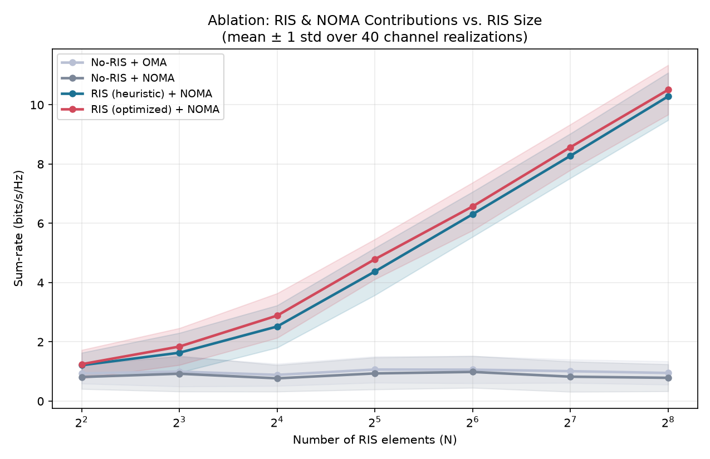
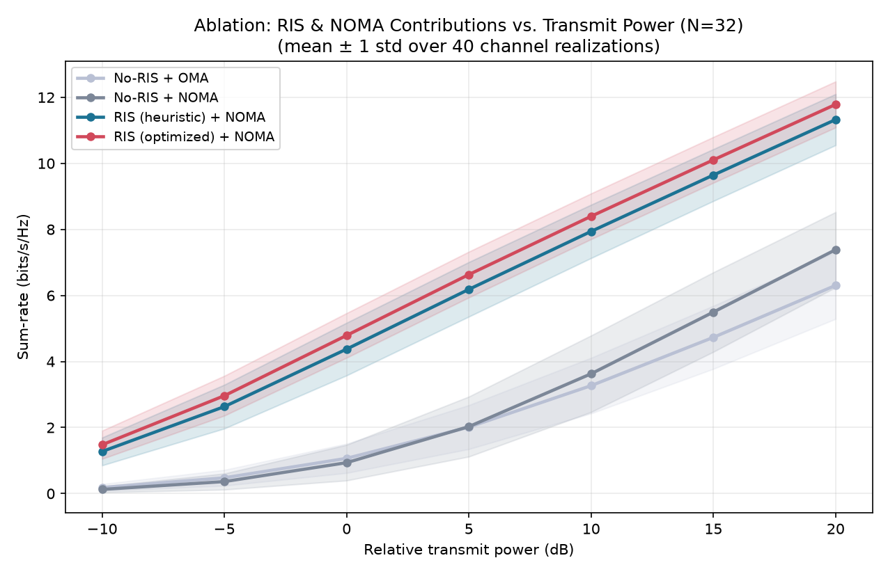
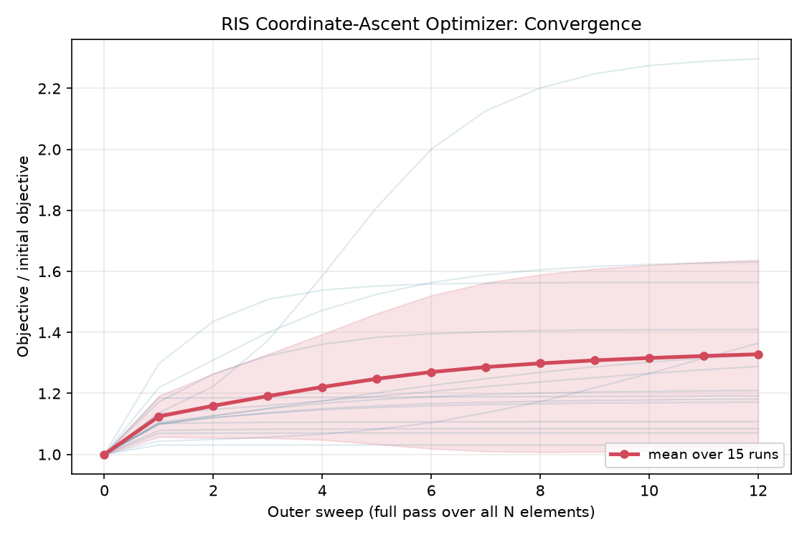
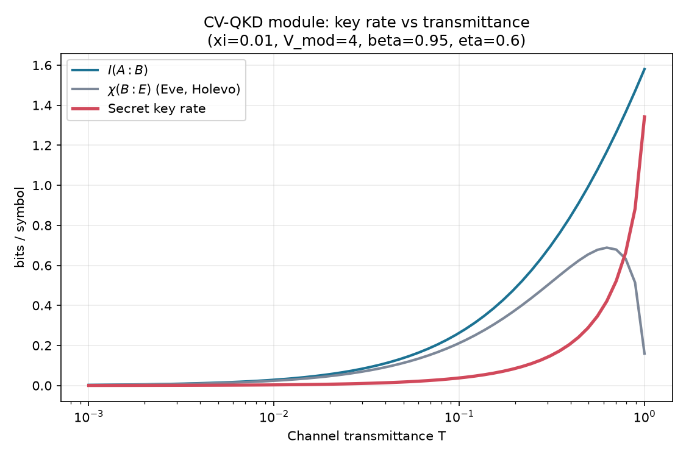
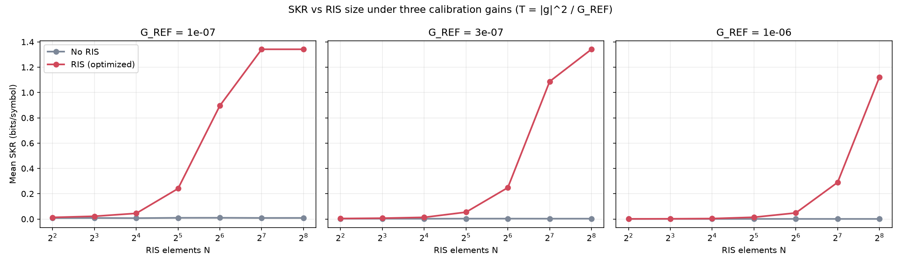

# RIS-Assisted Quantum-Secure Wireless Communication for 6G

Python simulation of an **RIS-assisted NOMA downlink with a CV-QKD security layer**.
B.Tech final-year project, ECE (SENSE), VIT Vellore. Guide: Dr. Budhaditya Bhattacharyya.

**Team:** Skandha Pavithra S, Rithika V, Nivandhini B L

## Idea

```
 Base Station ──H1──▶ RIS (N passive elements, phases θ) ──h2_k──▶ User k
      └───────────── h_d,k  (weak direct link) ───────────────────▶
```

1. **RIS** tunes reflection phases so reflected paths add coherently at the users.
2. **NOMA** serves K users on the same resource with power-domain multiplexing and SIC.
3. **CV-QKD** secret key rate depends on channel transmittance T, which is tied to the RIS-shaped channel.

Effective channel of user k: `g_k = (h2_k^H · Θ · H1 + h_d,k^T) · w`

## Layout

```
channel/channel_model.py   Rician BS-RIS / RIS-user links, Rayleigh direct link, path loss
ris/ris_optimizer.py       phase-alignment heuristic, coordinate-ascent optimizer, optional CVXPY-SDR stub
noma/noma_allocation.py    fractional power allocation, SIC rates, OMA baseline
qkd/qkd_model.py           heterodyne CV-QKD: SKR = beta*I(A:B) - chi(B:E)
sim/main.py                RIS/NOMA ablation + optimizer convergence
sim/qkd_experiments.py     SKR vs transmittance, SKR vs RIS size
tests/test_sanity.py       sanity checks (monotonic optimizer, NOMA ordering, QKD monotonicity)
results/                   generated figures and summary.csv
```

## Run

```bash
pip install -r requirements.txt
python tests/test_sanity.py
python sim/main.py              # ablation plots + convergence + summary.csv
python sim/qkd_experiments.py   # QKD plots
```

## Results

Setup: 4 BS antennas, 3 users, 40 random channel realizations per point (mean ± 1 std).

**Sum-rate vs RIS size** (N = 4 … 256)



- No-RIS baselines are flat in N (direct link only).
- At N = 256: RIS(optimized)+NOMA = 10.51 bits/s/Hz vs 0.79 (No-RIS+NOMA, 13.4x) and 0.95 (No-RIS+OMA, 11.1x). This holds for the chosen geometry (weak direct link, RIS close to users).
- Optimized beats the single-user heuristic, but only by about 2-10%.

**Sum-rate vs transmit power** (N = 32)



- Without RIS, OMA is slightly better at low SNR (≤ 0 dB). NOMA matches or beats OMA from about 5 dB upward.

**Optimizer convergence** (15 random channels, N = 32)



- The objective never decreases and flattens within about 10 sweeps.

**CV-QKD module**





- SKR increases monotonically with transmittance T.
- With T = |g|² / G_REF, SKR rises with RIS size. G_REF is a *calibration constant*, so the figure shows three values to make the dependence on it visible. SKR is capped at its T = 1 value.

## Method notes

- **RIS optimizer:** coordinate ascent. Each element's phase is chosen from a 120-point grid to maximize `Σ_k |g_k|²` with the other elements fixed, so the objective is non-decreasing. This maximizes channel gain (a proxy), not sum-rate or key rate.
- **NOMA:** power `p_k ∝ (1/|g_k|²)^α` with α = 0.6, decoding strongest-to-weakest with perfect SIC. OMA baseline: TDMA with 1/K time share and full power.
- **QKD:** Gaussian-modulated coherent states, heterodyne detection, reverse reconciliation, asymptotic key length, collective attacks, ideal detector. Parameters: V_A = 4, ξ = 0.01, β = 0.95. Formulas follow Laudenbach et al., *Adv. Quantum Technol.* 1, 1800011 (2018).

## Limitations

- RF-gain to QKD-transmittance mapping is a placeholder (fixed calibration gain), not a physical link budget.
- Fixed equal-gain BS beamformer; no joint beamforming + RIS optimization.
- Perfect SIC assumed (no error propagation).
- Asymptotic key length (no finite-size correction); ideal detector.
- `optimize_sum_rate_cvxpy` (SDR) is a single-user stub and is not used in the experiments.

## Roadmap

- [ ] Physical RF/optical link-budget coupling
- [ ] Optimize weighted sum-rate / SKR directly
- [ ] Joint BS beamforming + RIS optimization
- [ ] Imperfect SIC, finite-key CV-QKD, trusted-detector noise
- [ ] Compare CVXPY-SDR vs coordinate ascent
- [ ] Reproduce a published RIS-NOMA / RIS-CVQKD curve for validation

## License

MIT
